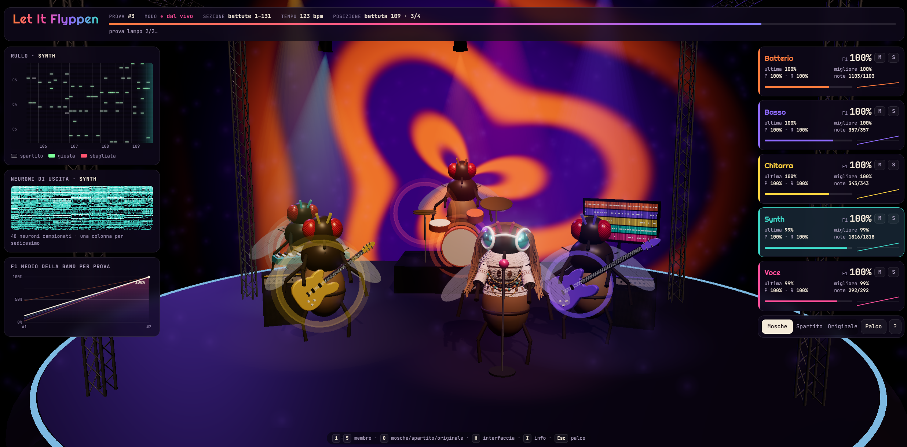

# Let It Flyppen

Five simulated fruit-fly brains, one per instrument (drums, bass, guitar, synth, vocals), learn to play Tame Impala's *Let It Happen*. You watch them on a 3D stage in the browser and hear them improve rehearsal after rehearsal.



## How it works

| Piece | What it is |
|---|---|
| **Brain** | The FlyWire v783 connectome (139k neurons, 15M connections) run with the leaky integrate-and-fire model of [Shiu et al. 2024](https://doi.org/10.1038/s41586-024-07763-9) on the GPU. Each fly has its own copy. At startup a probe finds the sub-circuit the input can actually drive (~1,700 neurons); the rest stays below threshold and never affects anything, so only that part is simulated. It runs in real time: ~80 ms of compute per sixteenth note, which lasts 122 ms. |
| **Ears** | The 1,055 Johnston's organ neurons of the antenna. Every sixteenth note they receive a spike code for the position in the song (beat within the bar + which bar). Each rehearsal the fly hears the same recording, so it gets the same input spikes. |
| **What learns** | The connectome is **frozen**: synapses never change. Only a linear readout learns, mapping the brain's 616 output neurons (spike counts in 4 time windows per sixteenth) to the notes. It is fitted online with recursive least squares (RLS): rehearsal 1 is chaos, rehearsal 2 is clean. |
| **Notes** | Extracted from the mp3. [Demucs](https://github.com/facebookresearch/demucs) separates the instruments (`htdemucs_ft` for drums/bass/vocals, `htdemucs_6s` for guitar/keys/other), [basic-pitch](https://github.com/spotify/basic-pitch) transcribes pitched parts, and drums are split into kick/snare/hi-hat by frequency band. You can also feed a multitrack MIDI file instead. |

Measured on the full song (2,105 sixteenths, 131 bars, 123 bpm), the F1 score (correct notes at the correct sixteenth) per part was:

| Rehearsal | Drums | Bass | Guitar | Synth | Vocals |
|---|---|---|---|---|---|
| 1 | 0.47 | 0.08 | 0.02 | 0.11 | 0.03 |
| 2 | 1.00 | 1.00 | 1.00 | 0.99 | 0.99 |
| 3 | 1.00 | 1.00 | 1.00 | 1.00 | 1.00 |

## Setup

You need [uv](https://docs.astral.sh/uv/), an NVIDIA GPU, and your own copy of the song as an mp3 (it is not included).

```bash
uv sync --extra prep                          # Python 3.10 + CUDA torch; "prep" is only needed to transcribe the song
uv run prep.py fetch                          # download the connectome and annotations (~135 MB) into data/
uv run prep.py song data/let-it-happen.mp3    # mp3 -> data/song.json (stems cached in data/stems)
uv run prep.py check                          # check the stems are complete
uv run brain.py                               # self-check: real time, active neurons, learning on 8 bars
```

Python is pinned to 3.10 because basic-pitch on Windows only works there (via ONNX); on newer versions it requires a TensorFlow build that doesn't exist.

## Play

Hear the whole song played clean as fast as possible:

```bash
uv run server.py --fresh --bars 0 131 --fast 2
```

The server listens to the whole song once (~3 minutes), runs 2 quick rehearsals in a few seconds, then plays live, already clean. Open <http://localhost:8000> and click **Enter the venue** to turn on the audio (add `#demo` to the URL for visuals only).

To hear the band go from chaos to clean instead:

```bash
uv run server.py --fresh                      # first 8 bars, from scratch, live: 1 messy rehearsal, then clean
```

What the band learns is saved in `data/readout.pt`. Without `--fresh` it picks up where it left off.

| Option | Effect |
|---|---|
| `--bars A B` | rehearse bars A to B (default `0 8`) |
| `--fast N` | N quick rehearsals before playing live |
| `--fresh` | forget what was learned and start from scratch |

## The stage

- **Listen** to *Flies* (what the brains play), *Score* (the transcribed notes on the same synths) or *Original* (the real recording, kept in sync with the band).
- **Member cards** show live F1, precision and recall, best and last rehearsal, and mute/solo buttons. Click a card to move the camera to that fly.
- The **piano roll** shows the selected member's expected notes (outlined) against the played ones (green if right, red if wrong).
- The **output-neuron raster** is a live heatmap of 48 real output neurons of the selected brain.
- The **chart** plots the band's average F1 per rehearsal.
- The vocalist is modelled on Kevin Parker: long centre-parted hair, white wraparound shades, a mohair sweater, necklaces.
- **Shortcuts**: `1`–`5` select a member, `O` cycles flies/score/original, `H` hides the UI, `I` opens the info panel, `Esc` returns to the stage view.

The audio is synthesized in the browser with Tone.js. "Clean" means the flies play exactly the transcribed notes, but it sounds like a MIDI rendition of the song, not the record. The transcription is automatic and imperfect, so a well-made MIDI file gives cleaner targets: `uv run prep.py song file.mid`.

## Files

| File | Purpose |
|---|---|
| `prep.py` | data: connectome download, stem separation, transcription into `song.json` |
| `brain.py` | the five LIF brains on the GPU and the RLS readout |
| `server.py` | endless rehearsals + WebSocket + the original recording for the stage |
| `web/` | 3D stage (Three.js, `stage.js`), audio and UI (Tone.js, `app.js`) |
| `assets/` | screenshot |
