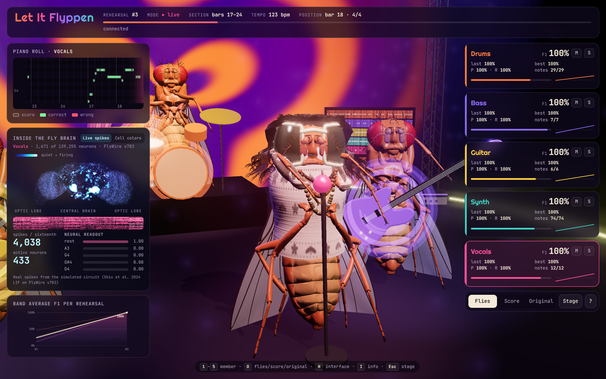

# Let It Flyppen

Five simulated fruit-fly brains, one per instrument (drums, bass, guitar, synth, vocals), learn to play Tame Impala's *Let It Happen*. You watch them on a 3D stage in the browser, see their neurons fire live, and hear them improve rehearsal after rehearsal.


## How it works

| Piece | What it is |
|---|---|
| **Brain** | The FlyWire v783 connectome (139k neurons, 15M connections) run with the leaky integrate-and-fire model of [Shiu et al. 2024](https://doi.org/10.1038/s41586-024-07763-9) on the GPU. Each fly has its own copy. At startup a probe finds the sub-circuit the input can actually drive (~1,700 neurons); the rest stays below threshold and never affects anything, so only that part is simulated. It runs in real time: ~70 ms of compute per sixteenth note, which lasts 120 ms. |
| **Ears** | The 1,055 Johnston's organ neurons of the antenna. Every sixteenth note they receive a spike code for the position in the song (beat within the bar + which bar). Each rehearsal the fly hears the same recording, so it gets the same input spikes. |
| **What learns** | The connectome is **frozen**: synapses never change. Only a linear readout learns, mapping the brain's 616 output neurons (spike counts in 4 time windows per sixteenth) to the notes, plus how loud and how long each note is. It is fitted online with recursive least squares (RLS): rehearsal 1 is chaos, rehearsal 2 is clean. |
| **Notes** | Extracted from the audio. The instruments are separated with [Demucs](https://github.com/facebookresearch/demucs) (`htdemucs_ft`, `htdemucs_6s`); the vocals with [BS-RoFormer](https://arxiv.org/abs/2309.02612), about 3 dB cleaner. The pitched parts are transcribed with [basic-pitch](https://github.com/spotify/basic-pitch), and the mono lines also with pYIN and [RMVPE](https://arxiv.org/abs/2306.15412). For every 16-bar section of every part, the transcription closest to its stem wins (chroma similarity). Drums are split into kick/snare/hi-hat by frequency band. You can also feed a multitrack MIDI file instead. |
| **Sound** | Stem mode: when a fly plays the right note at the right sixteenth, you hear **its own stem** at that point of the recording (lyrics included); a wrong note is played with a sample cut from the stem, so mistakes stay audible. The brains decide which notes, when, how loud and how long. |

Measured on *Let It Happen* (2,124 sixteenths, 132 bars, 125 bpm) after offline training (`brain.py train`, early stopping after 27 minutes):

| | Drums | Bass | Guitar | Synth | Vocals |
|---|---|---|---|---|---|
| F1 (right note, right sixteenth) | 1.000 | 1.000 | 1.000 | 1.000 | 1.000 |
| velocity error (0–1) | ±0.038 | ±0.045 | ±0.033 | ±0.044 | ±0.044 |
| length error (sixteenths) | – | ±0.16 | – | – | ±0.13 |

The brains reproduce the transcription exactly. What limits how faithful the band sounds is the transcription itself: `uv run prep.py score` shows how close each part is to its stem (chroma similarity 0–1). Here: bass 0.83, synth 0.80, vocals 0.58 and guitar 0.19, since the guitar is silent for most of the song. The vocals are weakest in bars 81–112 (0.39–0.43).

## Setup

You need [uv](https://docs.astral.sh/uv/), an NVIDIA GPU, and your own audio files (no song is included).

```bash
uv sync --extra prep                          # Python 3.10 + CUDA torch; "prep" is only needed to prepare the data
uv run prep.py fetch                          # download the connectome and annotations (~135 MB) into data/
uv run prep.py fly                            # download flybody and build the fly model (data/fly.glb)
uv run brain.py                               # self-check: real time, active neurons, learning on 8 bars
```

Python is pinned to 3.10 because basic-pitch on Windows only works there (via ONNX); on newer versions it requires a TensorFlow build that doesn't exist.

## Songs

Each song lives in its own folder, `data/songs/<name>/`: source file, stems, transcription, samples, web audio, and what the band learned (`readout.pt`, `train-log.json`). Preparing or training one song never touches another.

```bash
uv run prep.py song path/to/let-it-happen.mp3        # add a song (the name comes from the file, or pass one)
uv run prep.py song path/to/other.mp3 my-name        # another one
uv run prep.py list                                  # every song: prepared? trained? quality
uv run brain.py train                                # asks which song, trains it (early stopping, max 45 min)
uv run brain.py train let-it-happen 45               # or name it (a unique prefix is enough)
```

Preparing a song (~10 minutes on a GPU, the first time also downloads the models):

1. **Stems**: demucs for drums, bass, guitar, keys and other, and BS-RoFormer for the vocals.
2. **Tempo**: beat tracking, smoothed with a running straight-line fit, so the sixteenths follow the song's real tempo.
3. **Notes**: candidates from basic-pitch, plus pYIN and RMVPE for the mono lines. For every 16-bar section of every part, the candidate closest to the stem wins.
4. **Samples**: instrument samples cut from the stems.
5. **Web audio**: compressed stems and mix for the stage.

`uv run prep.py song <name>` redoes an existing song from its cached stems. `check` checks the stems, `score` prints transcription quality per section, and `samples` re-cuts the samples. Without a name, every per-song command asks which song.

## Play

```bash
uv run server.py                              # the most recently trained song, whole song
uv run server.py --song let-it-happen         # a specific one
```

Open <http://localhost:8000> and click **Enter the venue** to turn on the audio (add `#demo` to the URL for visuals only). The picker in the header switches song from the page. The server builds the new brains in ~20 seconds.

A song trained offline plays with its training untouched. A song not trained yet learns live (rehearsal 1 is chaos, rehearsal 2 is clean) and saves what it learned in its own folder.

| Option | Effect |
|---|---|
| `--song NAME` | which song to start with |
| `--bars A B` | rehearse only bars A to B |
| `--fast N` | N quick rehearsals before playing live (untrained songs) |
| `--fresh` | ignore the song's training and learn live from scratch |
| `--port P` | serve on another port (default 8000) |

Offline training simulates the song once, rehearses from that cache, and checks every rehearsal on a fresh simulation (F1, then velocity and length error). It tries a few RLS regularizations and keeps the best.

## The stage



- **Listen** to *Flies* (stem mode), *Samples* (the flies' notes on the sampled instruments), *Score* (the transcription on the samples) or *Original* (the real recording, kept in sync with the band). The **song picker** in the header switches song.
- **Inside the fly brain**: the selected fly's brain as a 3D point cloud (FlyWire neuron positions); the simulated neurons light up with their real spikes every sixteenth, by firing rate or by cell class. Below it: a raster of 48 output neurons, spike and active-neuron counters, and the readout's top 5 notes.
- **Member cards** show live F1, precision and recall, best and last rehearsal, and mute/solo buttons. Click a card to move the camera to that fly.
- The **piano roll** shows the selected member's expected notes (outlined) against the played ones (green if right, red if wrong).
- The **chart** plots the band's average F1 per rehearsal.
- The flies are the [flybody](https://github.com/TuragaLab/flybody) model, posed as musicians. The vocalist is modelled on Kevin Parker: dark shaggy hair with a fringe, ivory sunglasses with dark tinted lenses, a fluffy white mohair sweater with charcoal Nordic motifs, layered wooden-bead necklaces. Without `data/fly.glb` the stage falls back to simpler procedural flies.
- **Shortcuts**: `1`–`5` select a member, `O` cycles flies/score/original, `H` hides the UI, `I` opens the info panel, `Esc` returns to the stage view.

"Clean" means the flies play exactly the transcribed notes. The timbres are the song's own, but the parts are rebuilt note by note from an automatic transcription, so it is a reconstruction, not the record. A well-made MIDI file gives cleaner targets: `uv run prep.py song file.mid` (then the stage uses synths, since there are no stems to sample).

## Files

| File | Purpose |
|---|---|
| `prep.py` | data: connectome download, songs (separation, tempo, transcription, samples, web audio), flybody model |
| `brain.py` | the five LIF brains on the GPU and the RLS readout |
| `server.py` | endless rehearsals + WebSocket + recording, samples, brain map and fly model for the stage |
| `web/` | 3D stage (Three.js, `stage.js`), brain map (`brainmap.js`), audio and UI (Tone.js, `app.js`) |
| `assets/` | screenshots |

Generated data (`data/`: connectome, models, songs, fly model) is not in the repository.

## Credits

- Connectome: [FlyWire](https://flywire.ai) v783; model: Shiu et al., *Nature* 2024 ([code](https://github.com/philshiu/Drosophila_brain_model)).
- Fly model: [flybody](https://github.com/TuragaLab/flybody) by Google DeepMind and HHMI Janelia, Apache-2.0 (Vaxenburg et al., *Nature* 2025). `prep.py fly` downloads it and saves its license as `data/flybody-LICENSE`.
